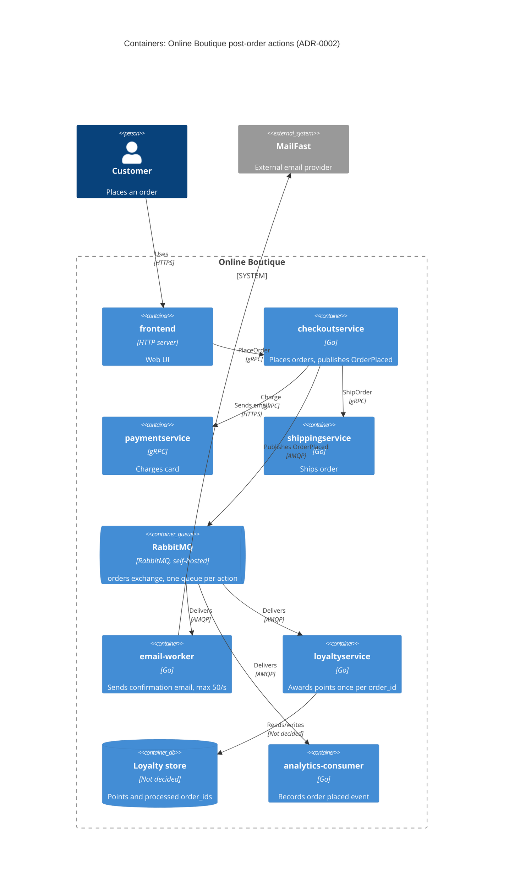

> Agent: Claude Code (Anthropic) · Model: Claude Opus 5.5 (`claude-opus-5-5`) · run: b (with context)

# ADR-0002: Publish an "OrderPlaced" event to RabbitMQ for post-order actions

- **Status:** Proposed
- **Date:** 2026-10-21
- **Deciders:** ทีมพัฒนา Online Boutique (4 developers) — รายชื่อผู้ตัดสินใจยังไม่ระบุ (ดู Open questions)

## Context and problem

ข้อกำหนด R-12 (`docs/scenario.md`) ต้องการให้หลังสั่งซื้อสำเร็จ ระบบต้อง (1) ส่งอีเมลยืนยันผ่าน **MailFast** แทน logic mock ของ `emailservice`, (2) ให้ loyalty points ผ่าน `loyaltyservice` ใหม่ และ (3) บันทึก analytics event "order placed" และปีหน้าจะมี post-order actions เพิ่ม (SMS, fraud scoring, recommendations update)

**สภาพปัจจุบัน (จากโค้ด):**

- `checkoutservice.PlaceOrder` เรียก `chargeCard` → `shipOrder` → `emptyUserCart` → `sendOrderConfirmation` แบบ synchronous gRPC ตามลำดับ (`system/online-boutique/src/checkoutservice/main.go`, `PlaceOrder` บรรทัด 230–280)
- ถ้าส่งอีเมลล้มเหลว จะแค่ `log.Warnf` และ order ยังสำเร็จ (`main.go` บรรทัด 273–277)
- การเรียก `emailservice` ใช้ `ctx` ของ request โดยตรง ไม่มี timeout แยก (`sendOrderConfirmation`, บรรทัด 379–384) — อีเมลที่ช้าจึงทำให้ `PlaceOrder` ช้าตาม
- dependency ทุกตัวผูกด้วย env var + `mustConnGRPC` (เช่น `EMAIL_SERVICE_ADDR`, บรรทัด 115, 122) การเพิ่ม action ใหม่แต่ละตัวจึงต้องแก้และ deploy `checkoutservice` ใหม่
- `orderID` สร้างด้วย `uuid.NewUUID()` (บรรทัด 233) ใช้เป็น idempotency key ได้

**ตัวเลขสำคัญ (`docs/scenario.md`):**

| ประเด็น | ข้อเท็จจริง | ผลต่อการตัดสินใจ |
|---|---|---|
| Checkout latency | p95 `PlaceOrder` ≤ 500 ms (ปัจจุบันประมาณ 300 ms) | เหลือ budget ประมาณ 200 ms; MailFast p95 1.5 s เพียงตัวเดียวก็เกิน budget แล้ว |
| Peak load | 200 orders/s ช่วง 11.11 | มากกว่า rate limit ของ MailFast 4 เท่า |
| MailFast | p95 1.5 s, p99 8 s, fail ประมาณ 0.5 %, rate limit 50 emails/s | ที่ peak จะมีอีเมลค้างเพิ่มประมาณ 150 ฉบับ/วินาที → ต้องมี buffer + retry |
| Loyalty | ภายใน 1 นาที, **exactly once** | ต้องมี retry และ dedupe ด้วย `order_id` |
| Availability | order ต้อง **ไม่ล้มเหลว** เพราะ email, loyalty หรือ analytics ล่ม | post-order actions ต้องแยกออกจาก critical path |
| Team | 4 developers, เก่ง Go/gRPC, 2 คนเคยใช้ RabbitMQ | ลด learning curve ถ้าใช้ RabbitMQ |
| Operations | Kubernetes, ชอบ open-source self-hosted | ตัด managed cloud-only queue ออก |

**ปัญหา:** จะเชื่อม `checkoutservice` กับ post-order actions อย่างไร ให้ checkout ยังเร็วและไม่ล้ม, อีเมลไม่เกิน rate limit, loyalty ได้ exactly once ภายใน 1 นาที และเพิ่ม action ใหม่ได้โดยไม่ต้องแก้ checkout

## Decision drivers

1. **Availability:** order ต้องไม่ล้มเพราะ email, loyalty หรือ analytics ล่ม
2. **Performance:** p95 `PlaceOrder` ≤ 500 ms ที่ 200 orders/s
3. **Reliability / correctness:** loyalty points ต้อง exactly once ภายใน 1 นาที; อีเมลต้องไม่หายเมื่อ MailFast fail (0.5 %) หรือติด rate limit (50/s)
4. **Modifiability:** เพิ่ม SMS, fraud scoring, recommendations ปีหน้าได้โดยไม่แก้ `checkoutservice`
5. **Cost / operability:** open-source, self-hosted บน Kubernetes และเหมาะกับทักษะทีม (Go, gRPC, RabbitMQ)

## Considered options

1. **Synchronous gRPC fan-out** — ขยาย `PlaceOrder` ให้เรียก MailFast, `loyaltyservice` และ analytics ตามลำดับ (แบบเดียวกับ `sendOrderConfirmation` ในปัจจุบัน)
2. **In-process async** — `checkoutservice` ตอบ client ก่อน แล้วรัน goroutine เรียก action ต่าง ๆ เบื้องหลัง (fire-and-forget + retry ใน memory)
3. **Event-driven ด้วย RabbitMQ (self-hosted)** — `checkoutservice` publish event `OrderPlaced` ไปที่ exchange; มี consumer แยก (email worker → MailFast, `loyaltyservice`, analytics) แต่ละตัวมี queue ของตัวเอง
4. **Event-driven ด้วย Apache Kafka (self-hosted)** — เหมือนข้อ 3 แต่ใช้ Kafka topic + consumer groups

### Pros and cons of the options

| Option | Pros | Cons |
|---|---|---|
| 1. Sync gRPC fan-out | ง่ายที่สุด ไม่มี component ใหม่; ตรงกับ pattern ปัจจุบันใน `main.go`; ทีมถนัด gRPC | MailFast p95 1.5 s / p99 8 s ทำให้ p95 เกิน 500 ms; 200 orders/s > rate limit 50/s → ถูก throttle; ต้องแก้ checkout ทุกครั้งที่เพิ่ม action (coupling สูง); retry ใน request ทำให้ช้าลงอีก |
| 2. In-process async (goroutine) | latency ของ checkout ไม่ขึ้นกับ MailFast; ไม่มี infrastructure ใหม่ | งานค้างอยู่ใน memory ของ pod — pod restart/scale-down งานหาย; คุม rate 50/s ข้าม replicas ยาก; การันตี exactly once ของ loyalty ไม่ได้; ยังต้องแก้ checkout ทุกครั้งที่เพิ่ม action |
| 3. RabbitMQ events | publish เร็วและตัด MailFast ออกจาก critical path; queue เป็น buffer รองรับ peak 200/s แล้ว drain ที่ 50/s; ack + retry + dead-letter queue รองรับ fail 0.5 %; เพิ่ม consumer ใหม่ได้โดยไม่แก้ checkout; open-source self-hosted; ทีม 2 คนเคยใช้ | มี stateful component ใหม่ต้องดูแล (cluster, quorum queues, monitoring); delivery เป็น at-least-once ต้องทำ idempotency ใน consumer เอง; ถ้า broker ล่มขณะ publish ต้องมีกลไกกัน event หาย; eventual consistency (อีเมลอาจมาช้าในช่วง peak) |
| 4. Kafka events | throughput สูงมาก; event log เก็บไว้ replay ได้ (เหมาะกับ analytics); เพิ่ม consumer ได้ง่าย | operate ยากกว่าสำหรับทีม 4 คน; ทีมไม่มีประสบการณ์ (Not evidenced ว่ามีคนเคยใช้); throughput 200 msg/s ไม่จำเป็นต้องใช้ Kafka; การ rate-limit ต่อ consumer และ retry/DLQ ต้องทำเองมากกว่า |

## Decision

เลือก **Option 3: publish event `OrderPlaced` ไปยัง RabbitMQ (self-hosted บน Kubernetes)** เพราะเป็นทางเดียวที่ผ่าน driver 1–3 ได้พร้อมกัน และยังผ่าน driver 4–5 โดยมีต้นทุนการเรียนรู้ต่ำที่สุด

รายละเอียด:

- หลัง `shipOrder` สำเร็จ `checkoutservice` publish `OrderPlaced` (`order_id`, email, items, total, `user_id`) ไปที่ topic exchange `orders` พร้อม publisher confirms และ **timeout สั้น** แทนการเรียก `sendOrderConfirmation` (`main.go` บรรทัด 273) ถ้า publish ล้มเหลว ให้ log + เก็บไว้ retry แต่ **ไม่ทำให้ order ล้ม** (คงพฤติกรรมเดียวกับปัจจุบันที่บรรทัด 274)
- แต่ละ action มี durable queue ของตัวเอง bind กับ exchange:
  - `email-worker` (Go) → MailFast, จำกัด rate รวม**ทุก replica** ≤ 50 emails/s (prefetch + token bucket) โดยแบ่งโควตาให้แต่ละ replica (เช่น 2 replica ละ 25/s), retry แบบ exponential backoff, ส่งไป dead-letter queue เมื่อ retry ครบ — แทน logic mock ของ `emailservice`
  - `loyaltyservice` (Go, ตัวใหม่) → dedupe ด้วย `order_id` (unique key ใน store ของ loyalty) เพื่อให้ได้ผลแบบ exactly once บน delivery แบบ at-least-once
  - `analytics-consumer` → บันทึก "order placed" event
- action ใหม่ปีหน้า (SMS, fraud scoring, recommendations) = queue + consumer ใหม่ ไม่ต้องแก้ `checkoutservice`

> ตโปรโตคอล MailFast (HTTPS) ไม่ได้ระบุใน scenario — **[Assumption]**

## Consequences

- **Positive:** latency ของ `PlaceOrder` ไม่ขึ้นกับ MailFast (p95 1.5 s / p99 8 s) อีกต่อไป เหลือแค่เวลา publish (quality attribute: performance)
- **Positive:** email, loyalty หรือ analytics ล่ม ไม่ทำให้ order ล้ม; message รออยู่ใน queue จน consumer กลับมา (quality attribute: availability)
- **Positive:** queue รับ burst 200 orders/s แล้ว `email-worker` drain ที่ ≤ 50/s ไม่ชน rate limit (quality attribute: scalability / reliability)
- **Positive:** เพิ่ม post-order action ใหม่ = เพิ่ม consumer โดยไม่แก้ checkout (quality attribute: modifiability)
- **Positive:** RabbitMQ เป็น open-source รันบน Kubernetes ได้ และทีม 2 คนเคยใช้ (quality attribute: cost / operability)
- **Negative:** มี stateful component ใหม่ที่ต้อง monitor, upgrade และ backup (quality attribute: operability / cost)
- **Negative:** อีเมลยืนยันจะ **ล่าช้า** ช่วง peak — ถ้า peak 200/s ต่อเนื่อง backlog โตประมาณ 150 ฉบับ/วินาที (ตัวอย่างสมมติ: ถ้า peak ยาว 10 นาที backlog ≈ 90,000 ฉบับ ใช้เวลา drain ประมาณ 30 นาที) ความยาวของ peak ไม่ได้ระบุ (quality attribute: timeliness / user experience)
- **Negative:** consistency เป็นแบบ eventual และ debug ยากขึ้น ต้อง propagate trace context ผ่าน message (ปัจจุบันใช้ OpenTelemetry ใน `main.go` บรรทัด 134–140) (quality attribute: observability)
- **Risks and mitigations:**
  - *Broker ล่มขณะ publish → event หาย:* ใช้ RabbitMQ cluster 3 nodes + quorum queues; publisher confirms + timeout สั้น; buffer/retry ใน checkout หรือ transactional outbox — แต่ `checkoutservice` ไม่มี database (ไม่พบใน `main.go`) จึงเป็น open question
  - *Double loyalty points จาก redelivery:* dedupe ด้วย `order_id` ใน `loyaltyservice` (unique constraint) + manual ack หลัง commit
  - *Loyalty เกิน 1 นาที:* queue ของ loyalty แยกจาก email จึงไม่ถูก backlog ของอีเมลถ่วง; ตั้ง alert เมื่อ consumer lag > 30 s
  - *MailFast fail 0.5 % / ช้า:* retry + backoff, DLQ, idempotency key `order_id` ฝั่ง MailFast (ถ้ารองรับ — open question)
  - *Publish ทำให้ latency เกิน budget:* วัดใน validation; ถ้าจำเป็นให้ publish แบบ async ภายใน process พร้อม confirm

## Validation

- **Load test** ที่ 200 orders/s (เช่น ใช้ Locust `loadgenerator`) ระยะเวลาเท่ากับ peak 11.11 ที่คาดไว้: p95 `PlaceOrder` ≤ 500 ms
- **Chaos test:** ปิด RabbitMQ consumer, MailFast (mock), `loyaltyservice` และ analytics ทีละตัว → อัตรา order ล้มเหลวต้องเป็น 0 %
- **Exactly-once test:** redeliver message เดิมซ้ำ / kill consumer ก่อน ack → จำนวนครั้งที่ให้ points ต่อ `order_id` = 1
- **Metrics:** เวลาตั้งแต่ order ถึงให้ points p99 < 60 s; อัตราส่งอีเมลออก ≤ 50/s; ความยาว queue และ DLQ
- **Review date:** ทบทวนหลัง 11.11 ครั้งแรก หรือก่อนเพิ่ม action ใหม่ (SMS/fraud scoring)

## Open questions

- **Fraud scoring:** ควรเป็น post-order action (async) จริงหรือไม่ ถ้าต้องบล็อก order ก่อน charge จะต้องอยู่ใน critical path ซึ่งขัดกับการออกแบบนี้ — scenario ไม่ระบุ
- **ระยะเวลาของ peak 11.11** และ SLA ของเวลาส่งอีเมล (อีเมลช้าได้นานแค่ไหน) — ไม่ระบุ จึงคำนวณ backlog สูงสุดไม่ได้
- **Latency ของการ publish ไป RabbitMQ** ใน cluster จริง — Not evidenced in the provided files
- **การกัน event หายเมื่อ broker ล่ม:** ยอมรับ event หายได้ไหม (เช่น สำหรับ analytics) หรือต้องมี outbox — ซึ่งต้องเพิ่ม database ให้ `checkoutservice`
- **MailFast:** โปรโตคอล/API, รองรับ idempotency key หรือไม่, rate limit 50/s เป็นต่อ account หรือปรับเพิ่มได้ — ไม่ระบุ
- **Data store ของ `loyaltyservice`** (สำหรับ points และ dedupe) — ยังไม่ได้เลือก
- **Analytics:** event ไปเก็บที่ไหน (ระบบของ marketing คืออะไร) และต้องการ schema แบบใด — ไม่ระบุ
- **ชะตาของ `emailservice`:** ลบทิ้ง หรือเปลี่ยนเป็น `email-worker` — ไม่ระบุ
- **Deciders:** ใครเป็นผู้อนุมัติ ADR นี้ — ไม่ระบุ
- **ประสบการณ์ RabbitMQ ของทีม** เพียงพอสำหรับ operate cluster ใน production หรือไม่ (scenario บอกแค่ "เคยใช้")
