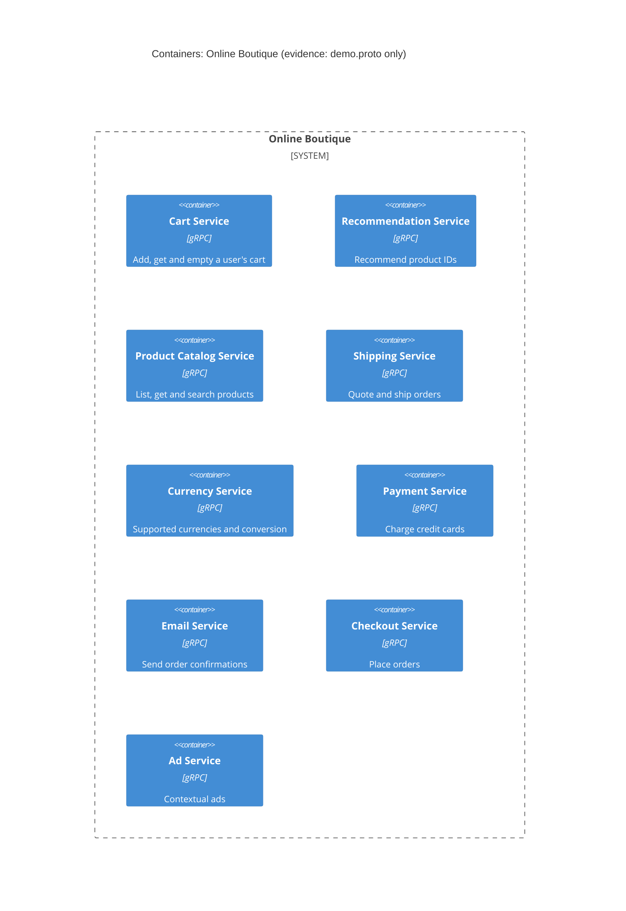

# Task 1 – Run A: Recovered container architecture

## 1. Agent

Claude Code (Anthropic), model Claude Opus 5.5 (`claude-opus-5-5`).

## 2. Files read

- `prompts/1-recover-architecture.md` (task instructions)
- `system/online-boutique/protos/demo.proto` (only evidence file)

## 3. Containers table

Every service below is a gRPC service defined in Protocol Buffers (`syntax = "proto3"`, `package hipstershop`). The proto file does **not** say which language each service is written in. `option go_package` (line 19) only shows that Go stubs are generated, so the language column says "Not evidenced in the provided files".

| Container | Technology / language | Responsibility (from RPCs) | Evidence |
|---|---|---|---|
| Cart Service | gRPC API; language not evidenced | Adds items to a user's cart, gets the cart, empties it (`AddItem`, `GetCart`, `EmptyCart`) | `system/online-boutique/protos/demo.proto` (`service CartService`, l.23–27) |
| Recommendation Service | gRPC API; language not evidenced | Recommends product IDs for a user and a list of products (`ListRecommendations`) | `system/online-boutique/protos/demo.proto` (`service RecommendationService`, l.56–58) |
| Product Catalog Service | gRPC API; language not evidenced | Lists, gets and searches products (`ListProducts`, `GetProduct`, `SearchProducts`) | `system/online-boutique/protos/demo.proto` (`service ProductCatalogService`, l.71–75) |
| Shipping Service | gRPC API; language not evidenced | Quotes shipping cost and ships orders, returning a tracking ID (`GetQuote`, `ShipOrder`) | `system/online-boutique/protos/demo.proto` (`service ShippingService`, l.107–110) |
| Currency Service | gRPC API; language not evidenced | Lists supported currencies and converts `Money` amounts (`GetSupportedCurrencies`, `Convert`) | `system/online-boutique/protos/demo.proto` (`service CurrencyService`, l.140–143) |
| Payment Service | gRPC API; language not evidenced | Charges a credit card and returns a transaction ID (`Charge`) | `system/online-boutique/protos/demo.proto` (`service PaymentService`, l.177–179) |
| Email Service | gRPC API; language not evidenced | Sends order confirmation emails (`SendOrderConfirmation`) | `system/online-boutique/protos/demo.proto` (`service EmailService`, l.199–201) |
| Checkout Service | gRPC API; language not evidenced | Places an order and returns an `OrderResult` (`PlaceOrder`) | `system/online-boutique/protos/demo.proto` (`service CheckoutService`, l.224–226) |
| Ad Service | gRPC API; language not evidenced | Returns ads for a set of page context keywords (`GetAds`) | `system/online-boutique/protos/demo.proto` (`service AdService`, l.243–245) |

No data stores, message brokers, UI or external systems are evidenced.

## 4. Dependencies table

| Caller → Callee | Protocol | Evidence |
|---|---|---|
| *(none evidenced)* | – | `demo.proto` defines the services each container offers, not the clients that call them. No caller → callee relationship can be proven from this file. |

Possible dependencies inferred from shared message types are listed under **Gaps**.

## 5. Mermaid diagram

The diagram matches the tables. It has no `Person`, `System_Ext` or `Rel` elements because the evidence shows no end user, external system or dependency (see **Gaps**).

## 6. Gaps

| Gap | What the proto suggests (if anything) | File that would settle it |
|---|---|---|
| **Who calls which service** (all dependencies) | **[Inferred]** `CheckoutService` probably calls Cart, Product Catalog, Currency, Shipping, Payment and Email. Its request and response reuse `CreditCardInfo`, `Address` and `OrderResult` (l.228–239), which are the inputs and outputs of `Charge`, `ShipOrder` and `SendOrderConfirmation`. **[Inferred]** `RecommendationService` probably calls Product Catalog, since it returns product IDs. Neither is proven. | `system/online-boutique/kubernetes-manifests/*.yaml` (`*_SERVICE_ADDR` env vars); service source code under `system/online-boutique/src/*/` |
| **End user and front end / UI** | No HTTP or web front-end service appears in the proto. Nothing calls `CheckoutService.PlaceOrder` or `AdService.GetAds`. **[Inferred]** a front-end container exists that does. | `system/online-boutique/kubernetes-manifests/frontend.yaml`; `system/online-boutique/src/frontend/` |
| **Implementation language of each service** | Only `go_package` (l.19), which is a stub-generation option and not a service language | Each service's source directory or Dockerfile under `system/online-boutique/src/` |
| **Data stores** (for example, where carts are stored) | `CartService` keeps per-user state (`user_id`, l.43–50), but no store is named | `system/online-boutique/kubernetes-manifests/cartservice.yaml`; `system/online-boutique/src/cartservice/` |
| **External systems** (real payment provider, email server) | `Charge` and `SendOrderConfirmation` exist, but nothing shows whether they call external providers | `system/online-boutique/src/paymentservice/`, `system/online-boutique/src/emailservice/` |
| **Ports, deployment, replicas** | Not evidenced in the provided files | `system/online-boutique/kubernetes-manifests/` |
| **Asynchronous messaging** | All RPCs are unary request/response, and no broker appears. Absence here does not prove there is none. | `system/online-boutique/kubernetes-manifests/` |
