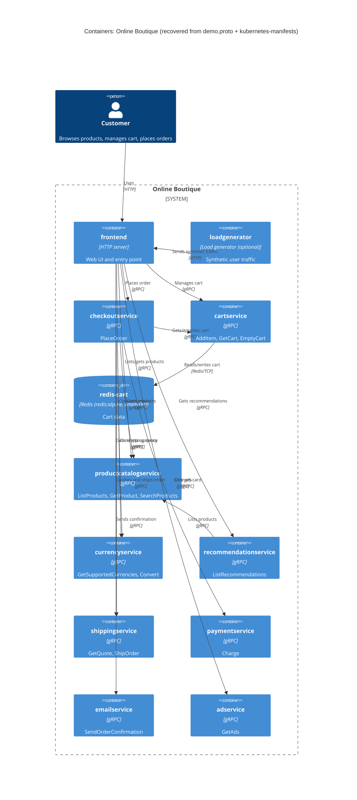

# Task 1 – Run B: Recovered C4 container architecture (Online Boutique)

## 1. Agent

- Product: Claude Code (desktop app, Code tab)
- Model: Claude Opus 5.5 (`claude-opus-5-5`)

## 2. Files read

Task instructions: `prompts/1-recover-architecture.md` (and `AGENTS.md` / `CLAUDE.md`, loaded automatically as repository rules).

Evidence:

- `system/online-boutique/protos/demo.proto`
- `system/online-boutique/kubernetes-manifests/README.md`
- `system/online-boutique/kubernetes-manifests/kustomization.yaml`
- `system/online-boutique/kubernetes-manifests/adservice.yaml`
- `system/online-boutique/kubernetes-manifests/cartservice.yaml`
- `system/online-boutique/kubernetes-manifests/checkoutservice.yaml`
- `system/online-boutique/kubernetes-manifests/currencyservice.yaml`
- `system/online-boutique/kubernetes-manifests/emailservice.yaml`
- `system/online-boutique/kubernetes-manifests/frontend.yaml`
- `system/online-boutique/kubernetes-manifests/loadgenerator.yaml`
- `system/online-boutique/kubernetes-manifests/paymentservice.yaml`
- `system/online-boutique/kubernetes-manifests/productcatalogservice.yaml`
- `system/online-boutique/kubernetes-manifests/recommendationservice.yaml`
- `system/online-boutique/kubernetes-manifests/shippingservice.yaml`

## 3. Containers table

"Technology" lists only what the evidence shows. The images are local build names (e.g. `image: adservice`), so the **implementation language is not evidenced** for any service (see Gaps).

| Container | Technology / language | Responsibility | Evidence |
|---|---|---|---|
| `frontend` | HTTP server on port 8080 (language not evidenced) | Web UI and entry point. Exposed outside the cluster via the `frontend-external` `LoadBalancer` Service on port 80. Calls 7 backend services. | `kubernetes-manifests/frontend.yaml` (`containerPort: 8080`, `httpGet /_healthz`, Service `frontend-external` `type: LoadBalancer`) |
| `cartservice` | gRPC server on port 7070 (language not evidenced) | Shopping cart: `AddItem`, `GetCart`, `EmptyCart` | `protos/demo.proto` (`service CartService`); `kubernetes-manifests/cartservice.yaml` (Service port `grpc` 7070, `grpc` probes) |
| `redis-cart` | Redis (`redis:alpine`), port 6379 | Cart data store. Its data is in an `emptyDir` volume, so it is **not persistent** across pod rescheduling. | `kubernetes-manifests/cartservice.yaml` (Deployment `redis-cart`, `image: redis:alpine`, `volumes: redis-data emptyDir`) |
| `productcatalogservice` | gRPC server on port 3550 (language not evidenced) | Product catalogue: `ListProducts`, `GetProduct`, `SearchProducts` | `protos/demo.proto` (`service ProductCatalogService`); `kubernetes-manifests/productcatalogservice.yaml` |
| `currencyservice` | gRPC server on port 7000 (language not evidenced) | Currency list and conversion: `GetSupportedCurrencies`, `Convert` | `protos/demo.proto` (`service CurrencyService`); `kubernetes-manifests/currencyservice.yaml` |
| `recommendationservice` | gRPC server on port 8080 (language not evidenced) | Product recommendations: `ListRecommendations` | `protos/demo.proto` (`service RecommendationService`); `kubernetes-manifests/recommendationservice.yaml` |
| `shippingservice` | gRPC server on port 50051 (language not evidenced) | Shipping quotes and orders: `GetQuote`, `ShipOrder` (returns `tracking_id`) | `protos/demo.proto` (`service ShippingService`); `kubernetes-manifests/shippingservice.yaml` |
| `checkoutservice` | gRPC server on port 5050 (language not evidenced) | Places orders: `PlaceOrder`, returning an `OrderResult`. Calls 6 backend services. | `protos/demo.proto` (`service CheckoutService`); `kubernetes-manifests/checkoutservice.yaml` |
| `paymentservice` | gRPC server on port 50051 (language not evidenced) | Charges a credit card: `Charge` (returns `transaction_id`) | `protos/demo.proto` (`service PaymentService`); `kubernetes-manifests/paymentservice.yaml` |
| `emailservice` | gRPC server; Service port 5000 → container port 8080 (language not evidenced) | Sends order confirmations: `SendOrderConfirmation` | `protos/demo.proto` (`service EmailService`); `kubernetes-manifests/emailservice.yaml` (Service `port: 5000`, `targetPort: 8080`) |
| `adservice` | gRPC server on port 9555 (language not evidenced) | Contextual ads: `GetAds(context_keys)` | `protos/demo.proto` (`service AdService`); `kubernetes-manifests/adservice.yaml` |
| `loadgenerator` | Container image `loadgenerator`; init container `busybox` (language not evidenced) | Generates synthetic user traffic (`USERS=10`, `RATE=1`) against the frontend. **Optional.** It is commented out of `kustomization.yaml`, so it is not deployed by default. | `kubernetes-manifests/loadgenerator.yaml`; `kubernetes-manifests/kustomization.yaml` line 24 (`# - loadgenerator.yaml`) |

## 4. Dependencies table

Protocols: every backend Kubernetes Service names its port `grpc` and uses `grpc` readiness/liveness probes. `frontend` uses an `http` port and `httpGet` probes. `redis-cart` uses a port named `tcp-redis`.

| Caller → Callee | Protocol | Evidence (file · symbol / env var) |
|---|---|---|
| Customer → `frontend` | HTTP (port 80, `LoadBalancer`) | `kubernetes-manifests/frontend.yaml` (Service `frontend-external`, port `http` 80 → 8080) |
| `loadgenerator` → `frontend` | HTTP | `kubernetes-manifests/loadgenerator.yaml` (`FRONTEND_ADDR=frontend:80`; init script `wget http://${FRONTEND_ADDR}`) |
| `frontend` → `productcatalogservice` | gRPC | `kubernetes-manifests/frontend.yaml` (`PRODUCT_CATALOG_SERVICE_ADDR=productcatalogservice:3550`) |
| `frontend` → `currencyservice` | gRPC | `kubernetes-manifests/frontend.yaml` (`CURRENCY_SERVICE_ADDR=currencyservice:7000`) |
| `frontend` → `cartservice` | gRPC | `kubernetes-manifests/frontend.yaml` (`CART_SERVICE_ADDR=cartservice:7070`) |
| `frontend` → `recommendationservice` | gRPC | `kubernetes-manifests/frontend.yaml` (`RECOMMENDATION_SERVICE_ADDR=recommendationservice:8080`) |
| `frontend` → `shippingservice` | gRPC | `kubernetes-manifests/frontend.yaml` (`SHIPPING_SERVICE_ADDR=shippingservice:50051`) |
| `frontend` → `checkoutservice` | gRPC | `kubernetes-manifests/frontend.yaml` (`CHECKOUT_SERVICE_ADDR=checkoutservice:5050`) |
| `frontend` → `adservice` | gRPC | `kubernetes-manifests/frontend.yaml` (`AD_SERVICE_ADDR=adservice:9555`) |
| `checkoutservice` → `productcatalogservice` | gRPC | `kubernetes-manifests/checkoutservice.yaml` (`PRODUCT_CATALOG_SERVICE_ADDR=productcatalogservice:3550`) |
| `checkoutservice` → `shippingservice` | gRPC | `kubernetes-manifests/checkoutservice.yaml` (`SHIPPING_SERVICE_ADDR=shippingservice:50051`) |
| `checkoutservice` → `paymentservice` | gRPC | `kubernetes-manifests/checkoutservice.yaml` (`PAYMENT_SERVICE_ADDR=paymentservice:50051`) |
| `checkoutservice` → `emailservice` | gRPC | `kubernetes-manifests/checkoutservice.yaml` (`EMAIL_SERVICE_ADDR=emailservice:5000`) |
| `checkoutservice` → `currencyservice` | gRPC | `kubernetes-manifests/checkoutservice.yaml` (`CURRENCY_SERVICE_ADDR=currencyservice:7000`) |
| `checkoutservice` → `cartservice` | gRPC | `kubernetes-manifests/checkoutservice.yaml` (`CART_SERVICE_ADDR=cartservice:7070`) |
| `recommendationservice` → `productcatalogservice` | gRPC | `kubernetes-manifests/recommendationservice.yaml` (`PRODUCT_CATALOG_SERVICE_ADDR=productcatalogservice:3550`) |
| `cartservice` → `redis-cart` | Redis protocol over TCP (port 6379) | `kubernetes-manifests/cartservice.yaml` (`REDIS_ADDR=redis-cart:6379`; Service `redis-cart` port `tcp-redis`) |

No other runtime dependencies are evidenced: `productcatalogservice`, `currencyservice`, `shippingservice`, `paymentservice`, `emailservice` and `adservice` have no `*_ADDR` env vars, so they are leaf services.

## 5. Mermaid diagram

The `Rel` labels (e.g. "Charges card") come from the callee's RPC names in `demo.proto`. Which RPCs each caller actually invokes is **[Inferred]** (see Gaps). The edges themselves are evidenced by the env vars.

## 6. Gaps

| Gap | Why it is open | File(s) that would settle it |
|---|---|---|
| Implementation language/runtime of every service | Manifests use bare image names (`image: frontend`, …); the proto has only `go_package` (a code-generation option, not proof that services are written in Go) | `system/online-boutique/src/<service>/Dockerfile` or the source files in each `src/<service>/` |
| `shoppingassistantservice` | `frontend.yaml` sets `SHOPPING_ASSISTANT_SERVICE_ADDR=shoppingassistantservice:80`, but there is no manifest for it and `ENABLE_ASSISTANT` is commented out. It is excluded from the diagram as unproven. | `system/online-boutique/kustomize/components/shopping-assistant/`; `src/frontend/` (how the env var is used) |
| Packaging service | Only mentioned in a comment in `frontend.yaml` (`PACKAGING_SERVICE_URL`, "optional Google Cloud demo"). Not deployed. | `src/frontend/` source |
| External systems (real payment gateway, SMTP/email provider, shipping carrier) | No env vars or Services point outside the cluster. `paymentservice` and `emailservice` may be mocks **[Inferred]**, so no `System_Ext` is drawn. | `src/paymentservice/`, `src/emailservice/`, `src/shippingservice/` source |
| Which RPCs each caller uses (e.g. does `frontend` call `ShippingService.GetQuote` only?) | Env vars show *that* a caller connects, not *which* methods it calls | `src/frontend/`, `src/checkoutservice/`, `src/recommendationservice/` client code |
| Data source of `productcatalogservice` and `adservice` (file, DB, in-memory?) | No volume, DB address or config in the manifests | `src/productcatalogservice/`, `src/adservice/` |
| Alternative data stores (Memorystore, Spanner, AlloyDB for the cart) | Only listed as commented-out Kustomize components in `kustomization.yaml` lines 32–35 | `system/online-boutique/kustomize/components/{memorystore,spanner,alloydb}/` |
| Whether any interaction is asynchronous | All evidenced interfaces are unary gRPC RPCs (`demo.proto`); no message broker appears. Checkout→email may still be fire-and-forget in code. | `src/checkoutservice/` source |
| Whether `frontend` → backends really uses gRPC (vs. e.g. REST) | Inferred from the callee Services' port name `grpc` and the gRPC probes, not from the frontend itself | `src/frontend/` client code |
| Production image tags/registry and replica counts | `kubernetes-manifests/README.md` says these manifests need `skaffold` to insert images and points to `/release` | `system/online-boutique/release/kubernetes-manifests.yaml`, `skaffold.yaml` |
| Observability / tracing / profiler back-ends | Only `DISABLE_PROFILER` / `ENABLE_PROFILER` flags; `google-cloud-operations` component is commented out | `system/online-boutique/kustomize/components/google-cloud-operations/` |
